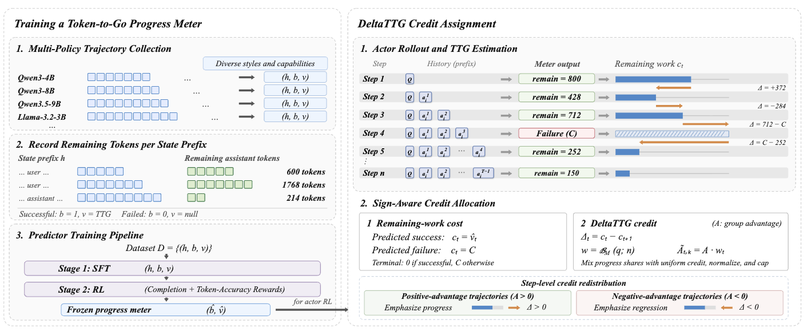
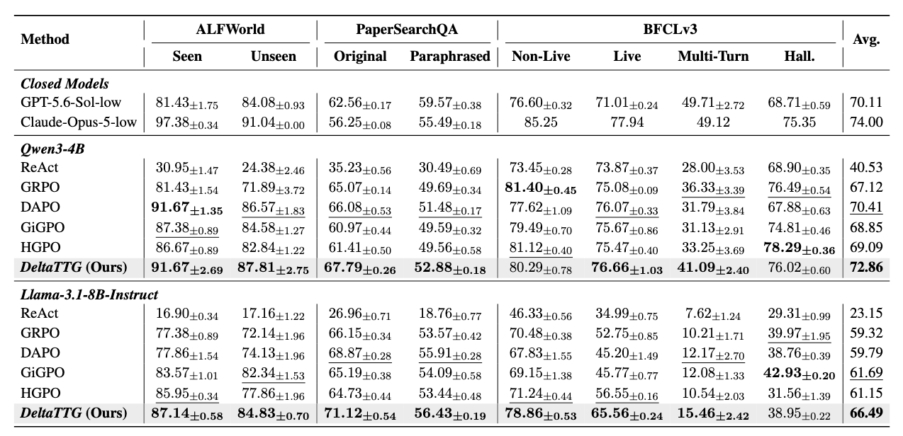
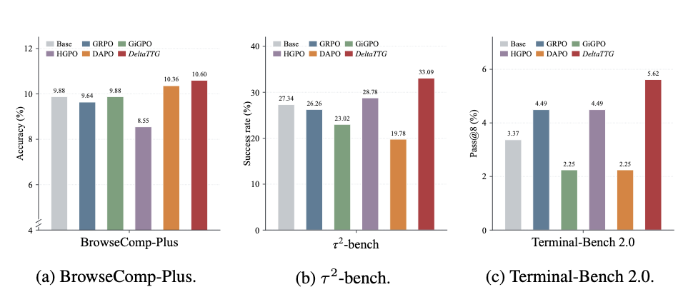

# DeltaTTG

Official implementation of **DeltaTTG**: learning a reusable task progress meter
for multi-turn agent training.

DeltaTTG learns task progress from recorded agent trajectories, using Token-to-Go
(TTG) as supervision for remaining completion effort. During actor training, a
frozen progress meter evaluates changes between consecutive decision histories
and redistributes outcome-derived advantages to provide fine-grained process
supervision.

## Method Overview

DeltaTTG trains a Token-to-Go progress meter, then uses the frozen meter for
sign-aware credit assignment during actor training.



## Results

### Main Results

Comparison with baseline methods on ALFWorld, PaperSearchQA, and BFCLv3.



### Out-of-Distribution Evaluation

Evaluation on BrowseComp-Plus, tau2-bench, and Terminal-Bench 2.0.



## Quick Start

### 1. Install

Use Linux, Python 3.11, and a CUDA toolkit compatible with PyTorch 2.8.0
(CUDA 12.8 for the commands below). Run from the repository root:

```bash
python -m pip install --upgrade pip setuptools wheel packaging ninja
python -m pip install torch==2.8.0 torchvision==0.23.0 torchaudio==2.8.0 --index-url https://download.pytorch.org/whl/cu128
python -m pip install flash-attn==2.8.3 --no-build-isolation
python -m pip install -e '.[vllm,gpu]'
python -m pip check
```

The CUDA profile pins vLLM 0.11.0, Transformers 4.57.3, and TensorDict 0.10.0
in `setup.py`. Install FlashAttention after PyTorch so its build can use the
installed CUDA runtime. Use a fresh environment: this distribution includes
its own `verl` Python package and should not coexist with a separately installed
`verl` distribution. Default training uses `use_fused_kernels=False`.

### 2. Prepare data and models

Prepare the actor model and progress-meter checkpoints in Hugging Face format.
Prepare ALFWorld assets and actor data:

```bash
export ALFWORLD_DATA="${ALFWORLD_DATA:-$PWD/data/alfworld}"
alfworld-download --data-dir "$ALFWORLD_DATA"
python -m data.alfworld
```

The launcher uses `data/alfworld` under the repository root by default. Keep
`ALFWORLD_DATA` set to the same absolute path when downloading and training if
you use a different location.

For PaperSearchQA, install a Java 11 JDK, set `JAVA_HOME` to that installation,
and ensure `java -version` reports Java 11. Then prepare the data and index:

```bash
python -m data.papersearchqa all
python -m data.build_bm25 --threads 8
python -m agent_system.environments.env_package.search.bm25_server \
  --index-path data/PaperSearchQA/indices/pubmed_bm25/bm25
```

Keep the retrieval service running while training. The default endpoint is
`http://127.0.0.1:8000/retrieve`; set `SEARCH_URL` for a different host or port.
The index builder validates the corpus and indexed document count before writing
`_SUCCESS`; it refuses to overwrite an existing index.

Construct meter SFT/RL data from recorded trajectories using:

```bash
python -m deltattg.meter.data.alfworld --help
python -m deltattg.meter.data.papersearchqa --help
```

Set data paths in `configs/`, through environment variables, or with
`--set KEY=VALUE`. Meter data construction requires recorded trajectories as input.

### 3. Train

The same launcher supports meter SFT, meter RL, and actor RL. Start by inspecting
the resolved configuration with `--dry-run`:

```bash
# Train the progress meter: SFT, then RL
bash scripts/train.sh --kind meter_sft --task alfworld \
  --set MODEL_PATH=./models/Qwen3-4B-Instruct-2507 --dry-run

bash scripts/train.sh --kind meter_rl --task alfworld \
  --set MODEL_PATH=./models/meter-sft --dry-run

# Train the actor with a frozen progress meter
bash scripts/train.sh --kind actor --task alfworld --model qwen3_4b \
  --set MODEL_PATH=./models/Qwen3-4B \
  --set METER_MODEL=./models/meter --dry-run
```

Replace the example model paths and check the data paths and GPU settings, then
remove `--dry-run` to launch training. `meter-sft` and `meter` refer to the exported
Hugging Face checkpoints from the preceding stages.

DeltaTTG actor training runs the frozen meter in a separate vLLM Ray worker on
one dedicated GPU. `ACTOR_GPUS` counts only the actor training/rollout GPUs:
the default `ACTOR_GPUS=2` and `METER_BACKEND=ray_vllm` require **three visible
GPUs in total**. Make all three GPUs available to the same Ray job; the meter
worker is started automatically. Startup checks include this extra meter GPU.
For example, set `CUDA_VISIBLE_DEVICES=0,1,2` before launching on a machine where
those are the allocated devices. Use your scheduler's assigned devices on a
cluster.

ALFWorld actor training (all methods/models), meter RL, and meter SFT save a
checkpoint every **20 training steps** and at the final training step. Set
`--set SAVE_FREQ=...` to override this interval. Existing checkpoint retention
settings still apply.

Use `--task papersearchqa` for PaperSearchQA or `--model llama31_8b` for the Llama
actor. GRPO, DAPO, GiGPO, and HGPO share the actor launcher and do not require a meter:

```bash
bash scripts/train.sh --kind actor --task alfworld --method gigpo --dry-run

bash scripts/train.sh --kind actor --task alfworld --model qwen3_4b \
  --method dapo --set MODEL_PATH=./models/Qwen3-4B --dry-run
```

DAPO uses GRPO advantages, clipping widths `0.2/0.28`, token-mean loss,
and dynamic sampling with actor KL loss disabled. Its defaults allow up to
10 generation batches per update and filter groups using a reward standard
deviation threshold of `1e-4`. Set `DAPO_MAX_NUM_GEN_BATCHES` or
`DAPO_MIN_REWARD_STD` with `--set` to override these settings. The same DAPO
profile supports both tasks and actor models; ALFWorld saves every 20 steps.

Task/model settings are in `configs/{actor,meter}/`; shared launch settings are
in `configs/launch/`. Additional training overrides follow `--`, for example
`-- trainer.total_training_steps=150`.

Invalid-action penalties have two actor modes: `--action-penalty-mode off`
(the default for every task/model) and `--action-penalty-mode on`. The on mode
subtracts `0.1` from each invalid action's reward; change the coefficient with
`--set INVALID_ACTION_PENALTY_COEF=...`. For example:

```bash
bash scripts/train.sh --kind actor --task alfworld --model llama31_8b \
  --method deltattg --action-penalty-mode on \
  --set METER_MODEL=./models/meter \
  --set EXP_NAME=llama31_8b-alfworld-deltattg-penalty-on --dry-run
```

Use a separate experiment name when comparing modes so checkpoints stay in
separate directories. Explicit mode selection overrides the legacy
`USE_INVALID_ACTION_PENALTY` environment setting; conflicting direct Hydra
overrides are rejected. The launch plan records the effective mode.

DeltaTTG redistributes credit only when a trajectory has one shared input
advantage. If per-action penalties produce different advantages, that
trajectory keeps its original per-action values and skips meter scoring.
`credit/nonuniform_advantage_fallback_count` records these fallbacks. The off
mode follows the paper's terminal-reward recipe. HGPO applies enabled penalties
before its history-group advantages are computed.

### Outcome-value ablation: −TTG (+value)

Supply your own frozen progress/value meter with `METER_MODEL`; this entry
does not train the meter or assume how it was trained:

```bash
bash scripts/train.sh --kind actor --task alfworld --model qwen3_4b \
  --method deltattg --ablation value \
  --set MODEL_PATH=./models/Qwen3-4B \
  --set METER_MODEL=./models/outcome-value-meter --dry-run
```

Use a Hugging Face causal-language-model checkpoint loadable by the selected
meter backend. The default is still `ray_vllm`, with one dedicated meter GPU
in addition to `ACTOR_GPUS`. Both actor models and both tasks are supported.
Remove `--dry-run` after checking the resolved paths to start actor training.

The meter receives the task and observable trajectory prefix and predicts the
final outcome score. Its output may be either:

```text
<answer>{"value":0.7}</answer>
```

or just `0.7`. Values must be finite JSON numbers (scientific notation is
accepted), on the same scale as the task's observed final reward. Scores are
not clamped to `[0, 1]`; larger values always mean better predicted outcomes.
Extra prose, booleans, NaN, and infinity are invalid. Both vLLM and Transformers
backends support this format, with the existing one-retry policy and whole
prompt-group GRPO fallback if parsing still fails.

This selects `credit_assignment.state_signal=outcome_value` and
`meter.output_mode=value_generation`. Progress is `S(next) - S(current)`;
the terminal value is the recorded `outcome_reward`, including fractional
scores, rather than the binary success flag or invalid-action penalties.
Sign-aware allocation, uniform mixing, token-weight normalization, and the
optional action-penalty modes are unchanged. A zero value is a valid score,
not a failed TTG prediction.

## Code Structure

| Directory | Contents |
| --- | --- |
| `deltattg/` | Progress meter, credit allocation, training integration, and test-time guidance |
| `data/` | Actor dataset download and preparation |
| `configs/` | Training profiles and ablations |
| `agent_system/` | Multi-turn rollouts and environment interfaces |
| `recipe/` | Baseline algorithms |
| `verl/` | Distributed training runtime |

## Tests

Run `python -m unittest discover -s tests -v` from the repository root. These
CPU regression tests cover configuration, meter GPU resource checks, and padded
evaluation shards, including a two-process Gloo collective test. CUDA/FSDP
training still requires validation on the target GPU environment.

## Acknowledgements

This implementation is built upon and adapted from
[verl](https://github.com/volcengine/verl) and
[verl-agent](https://github.com/langfengQ/verl-agent). We thank their authors and
contributors for the open-source training infrastructure and agent interaction
framework. 

## License

See [LICENSE](LICENSE) for DeltaTTG's Apache-2.0 license. Bundled components
retain their separate licenses listed in [Acknowledgements](#acknowledgements)
and [licenses/](licenses/). Downloaded models, datasets, and environment assets
retain their own licenses and are not relicensed by this source distribution.
